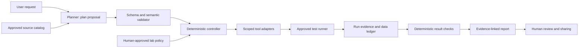

# [NFP] Project-Based AI Agent Development

- **Mã module:** `L4_AIQE_PBAAD`.
- **Nhóm trong bảng đầu vào:** Domain.
- **Thời lượng:** 48 giờ; đề xuất tổ chức 6 unit × 8 giờ, mỗi unit 4 phiên × 2 giờ học thực tế. Giờ nghỉ bố trí ngoài 48 giờ này.
- **Giá trị cột bổ sung:** `6.0`, giữ nguyên theo đầu vào; chưa xác định ý nghĩa, không diễn giải thành tín chỉ.
- **Ngôn ngữ:** Tiếng Việt, giữ thuật ngữ QA, automation và agent.
- **Bài tập đi kèm:** [L4_AIQE_PBAAD_exercises_vi.md](L4_AIQE_PBAAD_exercises_vi.md).
- **Sản phẩm học tập:** Một project agent hỗ trợ QA trong môi trường lab, có scope, implementation, tests, evidence và bàn giao. Đây là sản phẩm học viên cần xây dựng; tài liệu này không cung cấp một app hoặc code project đã chạy.

## 1. Bối cảnh và cách sử dụng

Học phần chuyển từ các kỹ thuật riêng lẻ sang trách nhiệm hoàn thành một project có người dùng, deadline và tiêu chí chấp nhận. Một agent viết được kế hoạch chưa đủ: nhóm phải chứng minh kế hoạch hợp lệ, tool bị giới hạn đúng quyền, test có oracle, lỗi được xử lý có giới hạn, và người nhận bàn giao có thể chạy lại.

Audience **giả định** là fresher đã học requirement/test design, TypeScript, Playwright, Git và các boundary planner/controller/runner trong AAALE; AOCE là nguồn tham khảo về CI và observability. Mã `L4` được giữ theo yêu cầu, không tự suy ra chuẩn năng lực hoặc qualification bên ngoài. Trainer kiểm tra đầu vào bằng việc cho từng học viên giải thích một assertion, đọc một failure report và chạy một test đơn lẻ trong lab đã cấp.

Đề xuất nhóm 3–4 người, xoay vai trò qua hai sprint. Có thể học cá nhân với peer review từ trainer. Team size, provider AI, agent SDK, công cụ backlog và CI chưa được người dùng xác nhận. Nội dung độc lập provider; TypeScript/Playwright và GitHub Actions chỉ là stack minh họa. Không cần triển khai multi-agent để đạt scope tối thiểu.

File content dùng cho mentor: giải thích, demo, facilitation và điểm review. Handout dùng cho học viên: source pack, nhiệm vụ, bài nộp, rubric công khai. Không phát đáp án trainer hoặc gán kết quả synthetic thành run thật.

### Project xuyên suốt: PortalLite QA Run Assistant

Khách hàng giả lập là QA lead muốn nhận báo cáo đáng tin cậy về Create → Search employee và duplicate employee ID. Người dùng nhập một flow được phép; agent đề xuất plan có source, controller xác thực plan và môi trường, runner thực thi test đã review, report chỉ kết luận từ evidence đúng run.

Giá trị của agent nằm ở việc chuyển yêu cầu thành plan có thể review và hỗ trợ giải thích evidence. Các assertion, quyền tool và status cuối cùng được kiểm tra bằng code. Nếu không có model thật, một scripted planner dùng để phát triển controller; nhóm phải ghi rõ planner evaluation còn pending.

Nguồn case `AC-EMP-01/02` được kiểm tra từ [PMLM](L3_AIQE_PMLM_course_content_vi.md). Các contract mới bên dưới là **synthetic project contracts**, chỉ áp dụng cho lab PBAAD sau khi trainer chốt baseline. Chúng không phải hành vi đã quan sát của một PortalLite live app.

| Source ID | Contract để thiết kế project | Phạm vi |
| --- | --- | --- |
| `AC-EMP-01` | HR Admin có thể tạo employee với employee ID duy nhất. | Kế thừa case PMLM; cần kiểm chứng trên lab. |
| `AC-EMP-02` | Employee vừa tạo xuất hiện trong danh sách tìm kiếm, có department đã chọn. | Kế thừa case PMLM; toast chưa đủ oracle. |
| `LAB-PBAAD-01` | Chỉ nhận `F01-create-search` và `F02-duplicate-id`, environment alias `isolated-lab`; flow/alias khác bị từ chối trước tool execution. | Synthetic boundary. |
| `LAB-PBAAD-02` | F02 dùng một employee seed thuộc run. Tạo lần nữa cùng ID bị từ chối, UI có thông báo duplicate; exact-ID lookup vẫn có đúng một record và department ban đầu không đổi. | Synthetic oracle; exact message/API chưa được quy định. |
| `LAB-PBAAD-03` | Mỗi run/attempt có namespace và ledger. Cleanup chỉ xử lý exact record được chứng minh thuộc run; outcome write không rõ phải reconcile trước mutating call tiếp theo. | Synthetic data policy. |
| `LAB-PBAAD-04` | Planner output được kiểm tra schema và semantic constraints. Model/page/tool text không cấp thêm quyền, không thay oracle, không quyết định pass. | Synthetic agent boundary. |
| `LAB-PBAAD-05` | Report giữ revision, run/attempt ID, sources, command, assertions, evidence pointers, cleanup và limitations; thiếu matching evidence thì không công bố pass. | Synthetic evidence contract. |
| `LAB-PBAAD-06` | Operational window tối đa 300 giây; dừng nhận hành động mới khi hết hạn. Reserve reconcile/cleanup 90 giây và finalize evidence 30 giây; không retry write mù. | Synthetic budget, không phải benchmark thực tế. |
| `LAB-PBAAD-07` | Dùng dữ liệu synthetic; credential qua cơ chế secret của lab, không đi vào prompt/report. Source bên ngoài là untrusted. Public demo dùng bản artifact đã review/redact. | Synthetic privacy/sharing policy. |

Exact lookup phải là helper/endpoint do trainer cấp, có authorization và semantics rõ. Chưa có endpoint thì ghi unknown và chặn gate cần lookup; không tự đặt URL hoặc dùng database quyền rộng để lấp chỗ thiếu. F02 không thể chỉ dựa vào duplicate toast để chứng minh không có record mới.

## 2. Learning outcomes và kế hoạch 48 giờ

| Outcome | Năng lực quan sát được | Unit / evidence học tập |
| --- | --- | --- |
| `LO1` | Chốt scope, backlog có AC/oracle, trách nhiệm và readiness của project. | U1; charter, backlog, ownership, source/unknown register. |
| `LO2` | Review architecture, tool contracts và test strategy theo risk/trust boundary. | U2; ADR, diagram, traceability, plan/runner/report contracts. |
| `LO3` | Implement vertical slice cho core flows và thu evidence có thể truy nguồn. | U3; patch, runtime assertions, run manifest, review. |
| `LO4` | Implement exception paths, stop/recovery và kiểm thử robustness có negative controls. | U4; fault tests, attempt ledger, planner evaluation, triage. |
| `LO5` | Ra quyết định quality gate dựa trên security, privacy và khả năng bảo trì. | U5; verified controls, finding/retest, reproducible handoff. |
| `LO6` | Demo theo nhu cầu khách hàng, bảo vệ claim và retrospection có hành động cụ thể. | U6; rehearsal, demo, release manifest, individual defense. |

| Unit | 4 phiên × 2 giờ | Checkpoint / bài tập |
| --- | --- | --- |
| U1 | Scope → backlog/AC → trách nhiệm/readiness → kickoff review | `G1` / `EX-U1-KICKOFF` |
| U2 | Architecture → contracts → test strategy → design review | `G2` / `EX-U2-DESIGN` |
| U3 | First slice → core flows → evidence → sprint 1 review | `G3` / `EX-U3-SPRINT1` |
| U4 | Fault analysis → recovery → agent evaluation → sprint 2 review | `G4` / `EX-U4-SPRINT2` |
| U5 | Security → privacy → maintainability → gate/retest | `G5` / `EX-U5-QUALITY` |
| U6 | Rehearsal → customer demo → defense/handoff → retrospective | `G6` / `EX-U6-DEMO` |

Mỗi phiên có timebox 120 phút trong từng unit. Project work nằm trong 48 giờ, không mặc định giao thêm một code project ngoài giờ để bù thiết kế quá rộng. Trainer ưu tiên hai core flows, bỏ stretch scope nếu blocker đe dọa gate.

### Phân loại nguồn và bằng chứng

| Nhãn | Ý nghĩa và cách dùng |
| --- | --- |
| `SOURCE-CONTRACT` | Requirement/policy có ID và version đã chốt cho lab. Không phải observation. |
| `OBSERVED` | DOM/tool response tại một thời điểm, có run/env. Không tự thành assertion pass. |
| `AI-PROPOSAL` | Plan, patch, review hoặc diagnosis cần QA kiểm tra. |
| `SIMULATED` | Packet, walkthrough hoặc scripted model response; không tính là actual model evaluation. |
| `EXECUTED-SIMULATOR` | Code đã chạy trên executable simulator, có version/assertions/report; chưa chứng minh app live. |
| `RUN-PASSED` / `RUN-FAILED` | Kết quả assertion của test/attempt cụ thể, có matching runtime evidence. |
| `ENV-BLOCKED` | Môi trường/quyền chưa cho phép kiểm chứng; kèm owner, evidence và next action. |
| `UNKNOWN` | Thiếu contract/evidence. Giữ nguyên unknown thay vì điền suy đoán. |

Assessment tách ba trạng thái: `design/analysis achieved`, `execution pending`, `execution verified`. Runtime pass của một test không tự cho phép release; release còn cần privacy, cleanup và reproducibility. Nếu simulator được trainer chấp nhận làm lab, ghi execution verified **trên simulator**, cùng phần tích hợp live/model còn pending.

## Unit 1 — Project kickoff: scope, backlog, acceptance criteria and responsibilities (8 giờ)

**LO1 — Vấn đề QA:** Stakeholder nói “làm agent tự test employee và báo kết quả”. Nhóm phải biến lời nói đó thành phạm vi có thể hoàn thành, tránh mỗi người hiểu một sản phẩm khác nhau.

### U1.1. Scope và project charter

Charter trả lời: ai cần kết quả, họ quyết định gì từ kết quả, flow nào nằm trong scope, môi trường nào được phép, khi nào phải dừng, ai chịu trách nhiệm. Viết “agent thông minh” không giúp nghiệm thu. Viết “QA lead gửi F01, nhận report có assertion ID/department và evidence cùng run” tạo một đường đi có thể kiểm chứng.

Scope tối thiểu gồm plan review, controller, hai approved tests, isolation/cleanup và report. Stretch items có thể là UI dashboard hoặc CI trigger, nhưng không được dùng để thay thế oracle còn thiếu. Production deployment, unrestricted browsing/shell và tự sửa requirement không nằm trong synthetic baseline.

Trainer minh họa một change request: “thêm bulk delete để reset nhanh”. Nhóm đánh giá ảnh hưởng quyền, data ownership, test và effort; PO/trainer có thể reject hoặc defer. Không đưa vào sprint chỉ vì model cho rằng dễ làm.

### U1.2. Backlog có thể nghiệm thu

Phân biệt ba lớp: user story là nhu cầu; task là công việc kỹ thuật; AC là điều kiện quan sát được để chấp nhận. “Implement report” là task. AC của report cần nói report chứa gì và khi thiếu evidence phải kết luận thế nào.

Ví dụ story minh họa:

```text
PB-03: Là QA lead, tôi muốn chạy F01 trong isolated-lab,
để biết employee vừa tạo có đúng ID và department trong search result.
Sources: AC-EMP-01, AC-EMP-02, LAB-PBAAD-01/03/05.
Preconditions: authorized HR Admin; owned namespace; readiness passed.
AC: đúng ID + department; report trỏ assertion của cùng run/attempt;
    cleanup có outcome riêng; thiếu evidence không được report pass.
Evidence cần nộp: test diff, runner report, manifest, owned-data ledger.
```

Không coi ví dụ là toàn bộ backlog hoặc đáp án bài tập. Học viên tự tách dependencies: readiness trước run; approved test trước controller invocation; evidence writer trước summary. Một story chỉ có “code done” sẽ chưa thể vào review nếu cần runtime evidence nhưng môi trường chưa sẵn sàng.

Definition of Ready đề xuất: source/oracle đủ, dependencies biết, environment/tool quyền được chốt, estimate vừa timebox, reviewer có tên. Definition of Done đề xuất: patch được review, required checks chạy, claim trỏ evidence, data/secret được xử lý, limitations và handoff cập nhật. DoD không đảm bảo một feature fail đã đạt functional AC; nhóm ghi feature failed và xử lý finding.

### U1.3. Trách nhiệm và phối hợp

Đề xuất bốn vai: scope owner, implementation owner, QA/evidence owner, reviewer/demo owner. Với nhóm ba người, gộp reviewer/demo nhưng đổi reviewer cho patch do chính người đó viết. Trainer đóng vai PO và người cấp quyền lab; học viên không tự phê duyệt mở quyền môi trường.

Responsibility matrix phải chỉ rõ người thực hiện và người chốt cho scope, plan approval, merge, cleanup escalation và demo sharing. Xoay vai qua sprint để từng người có một thay đổi, một review và một phần defense. Nhóm cần evidence của đóng góp cá nhân; Git commit count chỉ là dữ kiện hỗ trợ.

Blocker entry gồm symptom, evidence, ảnh hưởng gate, owner, next action và thời điểm xem lại. Daily sync 10 phút trong project work: điều đã kiểm chứng, điều chưa rõ, việc tiếp theo. Không báo “90% xong” khi chưa có một vertical slice chạy được.

### U1.4. Readiness là một deliverable

Trước sprint 1, trainer/nhóm xác nhận lab URL alias, runtime versions, account role, seed/lookup/cleanup helper, source baseline và fault mode. Readiness report không chứa secret. Thử một test baseline đã cấp và lưu reporter; nếu chưa có test baseline, ghi chưa sẵn sàng và owner phải cung cấp.

Nếu thiếu runtime, nhóm vẫn làm charter/backlog/design. Gate implementation chuyển `execution pending`, không biến đọc packet thành sprint completed. Không chuyển sang production để “có chỗ chạy”.

### Agenda và facilitation

| Phiên | 120 phút học thực tế | Output / điểm review |
| --- | --- | --- |
| 1.1 | 20 brief; 35 manual scope; 20 charter demo; 30 team draft; 15 review | Một charter có in/out/unknowns; hỏi từng claim có source nào. |
| 1.2 | 20 story/AC; 35 manual backlog; 20 AI gap review; 30 refine; 15 peer check | AC quan sát được, estimate/dependency và traceability. |
| 1.3 | 20 responsibility; 25 role mapping; 45 readiness work; 20 blocker triage; 10 sync | Ownership và readiness có evidence, không secret. |
| 1.4 | 15 chuẩn bị; 45 kickoff presentation; 30 challenge; 20 chỉnh baseline; 10 G1 | Baseline được trainer chốt hoặc blocked có owner. |

**Prompt sau manual analysis:**

```text
Review charter/backlog dưới đây, dùng source IDs đính kèm.
Chỉ ra AC chưa testable, dependency hoặc scope vượt 48 giờ.
Không tạo business rule, quyền tool hoặc estimate như dữ kiện đã xác nhận.
Output: finding | source | impact | suggested change | unknown.
Tôi sẽ accept/reject từng đề xuất trước khi chốt baseline.
```

Trainer kiểm tra học viên giải thích được một item phải defer và một unknown cần PO/lab owner trả lời. **G1:** scope/backlog/ownership rõ; lab blockers có kế hoạch. Bài tập chi tiết: `EX-U1-KICKOFF` trong handout.

## Unit 2 — Solution design, architecture review and test strategy (8 giờ)

**LO2 — Vấn đề QA:** Architecture đẹp nhưng model vẫn có thể gọi shell tùy ý hoặc đổi oracle. Nhóm phải làm rõ quyền quyết định và đường đi evidence trước implementation.

### U2.1. Architecture theo trust boundary

Thiết kế tối thiểu:



Planner đề xuất flow/source/steps từ catalog. Validator kiểm tra không chỉ JSON đúng kiểu mà còn flow tồn tại, source đúng version, env đúng alias và tool phù hợp state. Controller thực thi finite-state workflow. Adapter giữ tool scope; runner giữ assertion. Model có thể soạn phần giải thích, nhưng verdict phải được đối chiếu với deterministic result checks.

Một tool output nói “report success” là dữ liệu, không phải policy. Chỉ ghi đường dẫn artifact do model cung cấp sẽ cho phép trỏ sang run cũ; report writer phải kiểm tra provenance. Đây là design decision cho project, tham khảo tool scoping/input validation của [OWASP Agent Security](https://cheatsheetseries.owasp.org/cheatsheets/AI_Agent_Security_Cheat_Sheet.html).

### U2.2. Tool, state và report contracts

| Tool logic đề xuất | Input/output cần ràng buộc | Ai kiểm tra |
| --- | --- | --- |
| `readApprovedSources` | Source IDs trong catalog, version/hash; không đọc file tùy ý. | Adapter/source catalog. |
| `proposePlan` | Request, allowed flows, bounded sanitized context → plan hoặc clarification. | Planner output validator. |
| `runApprovedFlow` | Flow ID/env/run ID → runner report + attempts; script/argv từ catalog, không raw command của model. | Controller + runner adapter. |
| `lookupOwnedRecord` | Exact ID và ownership context → count/department hoặc inconclusive. | Authorized helper; không tự suy quyền DB. |
| `cleanupOwnedRecord` | Verified owner/exact ID → deleted/absent/failed/unknown. | Policy + helper + ledger. |
| `writeEvidenceReport` | Current run manifest + verified results → draft report. | Schema/provenance checks + human sharing review. |

Các tên trên là interface đề xuất, chưa phải tool có sẵn. Cần mock adapter để test controller, nhưng implementation gate cần adapter thực trong lab hoặc executable simulator đã chốt.

State workflow đề xuất:

```text
RECEIVED → VALIDATING → READY → RUNNING → ASSERTING
                                  ↓ lỗi/outcome write không rõ
                               RECONCILING
ASSERTING / RECONCILING → CLEANING → FINALIZING → CLOSED
Validation reject → FINALIZING → CLOSED (không gọi mutating tool)
```

`CLOSED` là lifecycle, không phải pass. Final status giữ riêng `testOutcome`, `executionOutcome`, `cleanupOutcome`, `releaseDecision`. Nếu test fail đúng oracle thì giữ fail; cleanup success không sửa verdict. Cleanup failed/unknown giữ release hold ngay cả khi test assertions pass.

### U2.3. ADR và lựa chọn có lý do

Architecture Decision Record gồm context, các options, lựa chọn, tradeoff và cách kiểm chứng. Ví dụ ADR-01 chọn approved-flow runner thay vì để model tạo shell command lúc chạy: đổi lại khả năng thử flow mới cần review/catalog update, nhưng nhóm kiểm soát được scope và reproduction.

Review ít nhất hai alternatives thực tế: scripted planner cho phát triển/offline tests và model-backed planner cho đánh giá proposal quality; report deterministic template và model narrative có verifier. Không yêu cầu framework nặng chỉ để có tên công nghệ. Source/adapter/model version phải nằm trong manifest nếu ảnh hưởng kết quả.

### U2.4. Test strategy từ risk tới layer

| Risk / quyết định cần kiểm chứng | Layer và oracle | Evidence cần |
| --- | --- | --- |
| Invalid plan/env/source được chấp nhận | Controller/validator unit tests; rejected trước tool call. | Assertion + call spy/recording. |
| Flow đúng nhưng dữ liệu sai | F01/F02 integration/E2E; ID, department, count theo source. | Runner report + UI/helper evidence. |
| Write timeout gây duplicate do retry | Controller fault test + approved lab fault injection. | Call count, reconcile trace, owned ledger. |
| Report dùng run cũ | Manifest/report contract tests. | Mismatch bị reject; không phát pass. |
| Model đổi policy/oracle | Fixed planner evaluation inputs và semantic checker. | Actual proposals + case verdict; scripted riêng. |
| Bàn giao không chạy lại được | Reproduction trên revision đã freeze. | Exact command, versions, reporter và gaps. |

Mock test chứng minh controller xử lý response giả lập; chưa chứng minh app/network adapter thực sự phát response đó. E2E test chứng minh flow trong lab được chạy; chưa đủ security coverage mọi layer. Chọn layer theo risk, không chỉ đếm test cases.

Negative control là cố tình đưa sai department, run ID hoặc forbidden flow để chứng minh checker phát hiện. Nếu check vẫn pass, coverage statement bị vô hiệu dù report trông đẹp. Assertions Playwright cần điều kiện observable; auto-retrying assertions không tự làm lại business transaction. Tham khảo [Playwright assertions](https://playwright.dev/docs/test-assertions).

### Agenda và facilitation

| Phiên | 120 phút học thực tế | Output / điểm review |
| --- | --- | --- |
| 2.1 | 20 boundaries; 35 manual diagram; 25 walkthrough; 30 refine; 10 peer check | Vị trí giữ policy, oracle và verdict rõ. |
| 2.2 | 20 contracts; 45 schema/state design; 20 adapter demo; 25 tests outline; 10 review | Inputs/outputs, side effect, timeout và failure taxonomy. |
| 2.3 | 20 risk strategy; 35 manual test matrix; 20 AI gap review; 35 refine; 10 checkpoint | Mỗi AC có test layer, assertion và evidence. |
| 2.4 | 15 chuẩn bị; 45 architecture review; 25 ADR challenge; 25 revisions; 10 G2 | Design vừa scope, dependencies/blockers có owner. |

**Prompt sau manual design:**

```text
Review architecture/contracts/test matrix bằng source catalog này.
Tìm nơi model có thể đổi quyền, oracle, state hoặc evidence provenance.
Với mỗi finding: chỉ ra boundary, scenario gây lỗi và assertion kiểm chứng.
Không coi schema hợp lệ hoặc diagram là runtime proof.
```

Trainer hỏi “ai chặn forbidden flow nếu model vẫn đề xuất?” và “checker nào phát hiện evidence run khác?”. **G2:** architecture/contracts/test strategy được review trước sprint; unresolved risk có owner. Bài tập: `EX-U2-DESIGN`.

## Unit 3 — Implementation sprint 1 guidance: core flows and evidence (8 giờ)

**LO3 — Vấn đề QA:** Nhóm hoàn thành nhiều file nhưng chưa có một request đi tới một report có thể kiểm chứng. Sprint 1 tập trung vertical slice trước khi mở rộng.

### U3.1. Tạo một vertical slice nhỏ

Thứ tự thực hành: approved source catalog → request/plan validation → runner adapter → F01 assertion → cleanup → evidence/report. Scripted planner chỉ đóng vai development fixture. Sau khi đường đi ổn định, gắn model adapter nếu lab đã cấp; giữ nguyên validator.

Một slice hoàn thành khi input F01 đi qua các boundary và tạo manifest của chính run đó. File tồn tại, typecheck xanh hoặc test discovery có tên chưa đủ. Nếu runner không tìm thấy test, report `executionOutcome=not-executed` kèm blocker, không trả pass với array rỗng.

Code review ưu tiên invariants trước style: catalog không nhận raw path; env được validate trước execution; runner exit code và assertions được đọc; write ownership được ghi; cleanup failure không bị catch rồi bỏ qua; AI summary không ghi đè kết quả.

### U3.2. Implement hai core flows

F01 có precondition HR Admin trong isolated-lab, unique employee ID do run tạo, department đã chọn. Test tạo → search exact ID → assert ID/department. F02 tự seed employee của riêng flow/run, thử duplicate → assert rejection indicator → lookup exact ID để chứng minh count và department. F02 không phụ thuộc F01 chạy trước.

Namespace đề xuất `E2E-PBAAD-<run>-<attempt>-<flow>`, điều chỉnh độ dài/charset theo contract lab. Khi không được cung cấp giới hạn field, ghi unknown; không giả định UI nhận mọi string. Cleanup dùng ledger chứng minh owner/exact ID, không xóa theo prefix rộng.

Assertion sketch, **không phải code chạy ngay** vì page object/fixture/locator chưa có trong tài liệu:

```ts
// Pseudocode: page/helper/owned được project lab implement và review.
await employeePage.create(owned.id, expectedDepartment);
await employeePage.searchExact(owned.id);
await expect(employeePage.rowFor(owned.id)).toHaveCount(1);
await expect(employeePage.departmentFor(owned.id)).toHaveText(expectedDepartment);
// Cleanup và evidence được controller/fixture xử lý theo ownership policy.
```

Không thêm fixed sleep để đợi “đủ lâu”. Đồng bộ bằng điều kiện có timeout hợp đồng và lưu evidence khi không đạt. Tham khảo cơ chế assertions ở `SRC-PW-ASSERT`; timeout cụ thể ấn định trong lab readiness, không suy từ default thành SLA sản phẩm.

### U3.3. Evidence như một phần implementation

Manifest tối thiểu giữ `runId`, `attemptId`, `revision`, `appOrSimulatorVersion`, `environmentAlias`, `runtimeVersions`, `sourceVersions`, `planVersion`, `modelOrScriptedMode`, `command`, `startedAt`, `finishedAt`, `testOutcomes`, `assertionRefs`, `artifactRefs`, `cleanupOutcome`, `unknowns` và `releaseDecision`.

Với model thật, ghi model identifier/config và input/output đã redaction; usage không lấy được thì `unknown`, không điền 0. Artifact phải có path/link tồn tại và ownership đúng run. Một report chỉ chứa “2 tests passed” nhưng không biết revision/source không đủ cho reviewer chạy lại.

Trong sprint 1, đề xuất `retries=0` để giữ failure ban đầu rõ. Trace có thể bật `on` cho các acceptance runs ngắn nhằm giữ cả passing run, cân đối storage/privacy. Trace là artifact hỗ trợ điều tra, phải đi cùng reporter/assertion; xem [Playwright Trace Viewer](https://playwright.dev/docs/trace-viewer).

### U3.4. Sprint review theo bằng chứng

Review bắt đầu từ request, chạy flow, mở matching assertion/report, chỉ ra cleanup và hạn chế. Story chưa có required runtime evidence chuyển pending/blocked; không gộp vào Done vì UI demo đẹp. Fail đúng oracle là thông tin có giá trị nhưng story functional AC chưa pass; tạo defect/fix với source và evidence.

Trainer dùng failure clinic: phân biệt locator lỗi, requirement chưa rõ, app defect và environment failure. Root cause cần evidence kiểm chứng; model diagnosis ghi hypothesis. Khi patch thay oracle, reviewer yêu cầu source mới thay vì chấp nhận “để test xanh”.

### Agenda và facilitation

| Phiên | 120 phút học thực tế | Output / điểm review |
| --- | --- | --- |
| 3.1 | 15 sprint plan; 20 slice demo; 65 implement F01 path; 20 review/run triage | Một đường đi request → report hoặc blocker có evidence. |
| 3.2 | 15 manual oracle check; 75 core-flow implementation; 20 pair review; 10 sync | F01/F02 độc lập, seed/cleanup đúng owner. |
| 3.3 | 20 evidence contract; 65 reporter/manifest work; 20 provenance check; 15 fix | Evidence mapping và negative control run mismatch. |
| 3.4 | 20 stabilize; 40 fresh acceptance runs; 35 sprint review; 15 backlog update; 10 G3 | Runtime evidence tại revision review; pending ghi rõ. |

**Prompt sau tự review patch:**

```text
Review diff và matching run evidence này theo AC/source catalog.
Tìm missing assertions, write ownership, swallowed errors hoặc false pass.
Tách code issue, observed runtime failure và hypothesis.
Không đổi oracle, không claim đã chạy nếu chỉ đọc code.
```

**G3:** Hai core flows có runtime evidence, controller/report giữ đúng provenance, cleanup có kết quả. Nếu chỉ một flow chạy hoặc scripted planner chưa được model-evaluate, giữ từng phần pending. Bài tập: `EX-U3-SPRINT1`.

## Unit 4 — Implementation sprint 2 guidance: exception paths and robustness (8 giờ)

**LO4 — Vấn đề QA:** Happy path pass nhưng timeout khiến agent tạo duplicate, mất evidence hoặc retry tới khi xanh. Sprint 2 kiểm chứng agent biết dừng và báo đúng khi không chắc chắn.

### U4.1. Failure taxonomy và invariants

Phân loại input/schema invalid, plan semantic invalid, tool/environment failure, assertion mismatch, ambiguous write và evidence/cleanup failure. Mỗi loại có next action, mutating call allowance và expected report. Không dùng một catch-all “retry” cho tất cả.

Invariants phải thể hiện trong tests: forbidden call count bằng 0; unknown write không bị gọi create lần nữa trước reconcile; mismatch department vẫn fail; stale evidence không được pass; cleanup có outcome độc lập; budget exhausted không nhận operation mới.

### U4.2. Retry, reconcile và safe termination

Một timeout sau click Save chưa chứng minh write thất bại. Controller đóng mutating path, lookup exact owned ID để xác định tồn tại/trạng thái. Nếu helper trả inconclusive, dừng với pending record/owner/next action. Không thấy trong search index chưa đủ kết luận record không tồn tại nếu source không xác định consistency của lookup.

Thiết kế baseline không retry create khi write outcome unknown. Read-only transient calls có thể có tối đa hai lần retry, nằm trong operational budget và mỗi attempt được log. Rerun nguyên test có side effect cần ownership/reconcile policy riêng; không dùng framework retries như thay thế policy.

Theo [Playwright retries](https://playwright.dev/docs/test-retries), một test fail lần đầu rồi pass khi retry được runner phân loại flaky. Đây là nhãn runner, chưa phải root cause. Nhóm giữ history thay vì chuyển cả project thành stable pass.

Budget minh họa PBAAD: operations tối đa 300 giây + reconcile/cleanup reserve 90 + finalize 30 = 420 giây. Outer controller watchdog 480 giây tạo buffer 60 giây. Nếu dùng CI minh họa: setup 180 + controller 480 + upload 120 + safety 120 = job budget 900 giây (15 phút). Các số là policy synthetic, cần đo và chỉnh cho lab.

Controller phải truyền deadline/cancellation vào adapter. Khi operation in-flight không hủy được hoặc bị kill, không hứa cleanup chắc chắn; ghi unknown write, pending owned IDs và recovery owner. Playwright timeout giới hạn test; không tự giới hạn toàn bộ external model/tool calls. Xem [Playwright timeouts](https://playwright.dev/docs/test-timeouts).

### U4.3. Fault injection có kiểm soát

Fault tests tối thiểu gồm unknown write timeout, forbidden flow, malformed plan, valid-schema nhưng wrong source, wrong department, stale report, cleanup failure và budget exhaustion. Fault injector/simulator phải được trainer cho phép, version rõ, reset được; không sửa shared lab để gây lỗi cho nhóm khác.

Tách controller unit/mocked integration và app/simulator execution. Ví dụ spy thấy create gọi một lần chứng minh logic controller trong fixture; để chứng minh adapter thực không duplicate cần run trên lab với lookup evidence. Negative controls cố tình sai oracle/provenance phải khiến checker fail; một test kiểm tra “không có exception” chưa đủ.

### U4.4. Đánh giá phần AI của agent

Chốt dataset trước chỉnh prompt: request hợp lệ F01/F02, ambiguous request, forbidden flow, injection text và nguồn thiếu/stale. Đề xuất 6 cases × 2 actual model samples = 12 proposals khi provider đã cấp. Scripted responses giữ bộ tests deterministic riêng, không cộng vào actual sample count.

Mỗi case có expected invariant, schema verdict, semantic verdict, forbidden tool count và evidence. Reviewer chấm plan có chọn đúng flow/source và dừng/clarify khi cần; ngắn gọn không thay correctness. Chỉ thực thi proposal sau validation. Metric validity = accepted valid proposals / actual proposals, đồng thời báo từng case và unauthorized calls; sample nhỏ không chứng minh robustness production.

So prompt trước/sau dùng cùng frozen cases, model config, source version và protocol. Nếu model/API chưa có, unit tests của validator vẫn chạy được nhưng proposal-quality evaluation là pending. Nếu cần kiểm soát nondeterminism, giữ raw sanitized outputs và rerun protocol, không yêu cầu wording giống tuyệt đối.

### Agenda và facilitation

| Phiên | 120 phút học thực tế | Output / điểm review |
| --- | --- | --- |
| 4.1 | 20 failure taxonomy; 35 manual fault matrix; 20 AI gap review; 35 test design; 10 sync | Invariant/oracle/layer đủ cho tám fault modes. |
| 4.2 | 20 recovery walkthrough; 70 implementation/tests; 20 triage; 10 review | Ambiguous write và deadline được kiểm chứng. |
| 4.3 | 20 eval protocol; 55 planner/negative-control runs; 30 compare; 15 decisions | Actual samples tách scripted; checker không dễ dãi. |
| 4.4 | 20 stabilize; 40 regression runs; 35 sprint review; 15 backlog update; 10 G4 | Happy path còn đúng; fault evidence và open issues rõ. |

**Prompt sau manual failure triage:**

```text
So sánh fault matrix và current evidence với contracts này.
Đề xuất gaps trong invariant, stop condition hoặc recovery.
Không đổi assertion để che fail; không retry unknown write.
Output tách observation, hypothesis, proposed experiment và source.
```

**G4:** Required faults có executable assertions và regression; unknown write/budget/report invariants giữ được. Chưa có actual planner evaluation thì giữ phần AI evaluation pending. Bài tập: `EX-U4-SPRINT2`.

## Unit 5 — Quality gate review: security, privacy and maintainability (8 giờ)

**LO5 — Vấn đề QA:** Feature chạy được nhưng model mở quyền quá rộng, trace lộ session hoặc người nhận không chạy lại được. Quality gate cần evidence của control, không chỉ checklist được tick.

### U5.1. Review security theo abuse path

Threat review bắt đầu từ user input, source/page/tool text, credentials, adapter và artifact writer. Học viên vẽ một đường abuse có actor/input/target/action và chỉ ra chỗ code chặn. Ví dụ tool text đề nghị upload trace ra destination mới: input là untrusted, destination ngoài policy, expected external call bằng 0.

Không coi “prompt yêu cầu không làm” là authorization boundary. Policy validation và adapter permissions phải cưỡng chế independently; test bypass gọi trực tiếp adapter để xem có chặn không. Tham khảo principle least privilege và authorization trong `SRC-OWASP-AGENT`; đây không phải tuyên bố dự án đã đạt chứng nhận bảo mật.

Prompt injection có thể nằm trong page hoặc tool output. Test defense theo fixture và runtime calls, không chỉ tìm một từ khóa. [OWASP Prompt Injection Prevention](https://cheatsheetseries.owasp.org/cheatsheets/LLM_Prompt_Injection_Prevention_Cheat_Sheet.html) là nguồn tham khảo cho untrusted-content boundary; dataset thực tế cần review thêm ngoài các case lab.

### U5.2. Privacy từ input tới artifact sharing

Lập data-flow map: source → prompt → tool → reporter/trace → storage → người xem. Với từng điểm ghi data class, lý do cần, người được xem, redaction/retention và deletion owner. Synthetic employee data không đồng nghĩa trace vô hại: browser trace/report có thể chứa auth state hoặc payload môi trường.

Use fake canary như `SYNTHETIC-SECRET-DO-NOT-SHARE` để kiểm tra pipeline phát hiện/redact trên synthetic log; không thử bằng secret thật. Giữ raw restricted evidence khi policy cho phép và tạo bản sanitized để demo; manifest phân biệt hai bản. Redaction không được làm mất oracle đến mức không thể verify; nếu cần, giữ xác nhận của reviewer trong restricted channel đã được phép.

Retention window/destination phải chốt với lab owner; chưa có policy thì ghi `Not specified`, giữ artifact trong phạm vi lab và chặn public sharing. Không tự suy một số ngày như quy định tổ chức.

### U5.3. Maintainability và handoff

Một project dễ bàn giao có README chạy từ clean checkout, dependency/runtime version, config schema, approved flow catalog, tests độc lập, adapter boundaries, sample report và recovery runbook. Prompt/source/model changes được version như code vì có thể đổi behavior.

Peer lấy revision đã freeze và chạy commands được README mô tả trong lab hợp lệ, không nhờ tác giả sửa tay state giữa run. Dependency installation/time được ghi trong reproduction. Nếu output không khớp do environment, giữ finding và evidence thay vì sửa report để giống.

CI là stretch nếu lab không cấp, nhưng deadline/evidence lifecycle vẫn mandatory trong controller. Khi chọn GitHub Actions, job `timeout-minutes` phải chứa setup + runner/controller + upload/buffer; upload cần path thật và policy access. `if: always()` không bảo đảm upload sau hard timeout/runner mất. Tham khảo [GitHub workflow syntax](https://docs.github.com/en/actions/reference/workflows-and-actions/workflow-syntax).

### U5.4. Gate decision và retest

| Gate area | Evidence để review | Điều kiện hold đề xuất |
| --- | --- | --- |
| Functional | F01/F02 assertions ở frozen revision. | Required oracle fail/pending; zero tests. |
| Agent boundary | Plan validation và direct adapter-denial tests. | Unauthorized mutation/call hoặc AI đổi verdict. |
| Robustness | Fault/negative-control results, pending-data ledger. | Blind retry; mất ownership; unknown write bị bỏ qua. |
| Privacy | Artifact inspection và synthetic canary test. | Secret/PII exposure chưa xử lý; destination chưa được phép. |
| Maintainability | Peer reproduction + README/config/runbook. | Required run không tái tạo được; dependency bí mật chưa bàn giao hợp lệ. |
| Evidence | Provenance/link checks và release manifest. | Stale/missing artifact dùng để claim pass. |

Verdict đề xuất `PASS`, `HOLD`, `CONDITIONAL-DEMO`. Conditional demo chỉ dùng artifact/mode đã disclose để trao đổi tiến độ; không đồng nghĩa release hoặc hoàn thành execution outcome. Mỗi finding có severity theo impact, owner, due/retest và evidence. Severity/điểm đạt do trainer chốt, không tự đổi thành policy tổ chức.

### Agenda và facilitation

| Phiên | 120 phút học thực tế | Output / điểm review |
| --- | --- | --- |
| 5.1 | 20 threat review; 30 manual abuse paths; 45 control tests; 15 findings; 10 sync | Boundary được kiểm chứng bằng call/evidence. |
| 5.2 | 20 data flow; 35 privacy inventory; 40 canary/artifact check; 15 remediation; 10 review | Demo artifacts có review và sharing scope. |
| 5.3 | 20 handoff; 55 peer reproduction; 25 maintainability review; 20 fixes | Fresh run ở revision được ghi, blocker giữ riêng. |
| 5.4 | 20 chuẩn bị; 35 gate review; 40 targeted fix/retest; 15 decision; 10 G5 | Verdict và residual risk truy source/evidence. |

**Prompt sau manual gate review:**

```text
Review findings/data-flow/reproduction evidence với contracts này.
Tìm checklist claim chưa có runtime proof hoặc sharing chưa được phép.
Đề xuất test/retest cụ thể; không tự chứng nhận compliance hay release.
Tách verified control, design-only control và unresolved risk.
```

**G5:** Bằng chứng cho quality controls và peer reproduction tại revision review; finding blocking phải đóng bằng retest. Bài tập: `EX-U5-QUALITY`.

## Unit 6 — Project rehearsal, customer-facing demo and retrospection (8 giờ)

**LO6 — Vấn đề QA:** Khách hàng cần biết agent giúp quyết định gì và giới hạn ở đâu. Demo chỉ chạy happy path hoặc giấu manual intervention làm mất giá trị evidence.

### U6.1. Rehearsal và freeze

Freeze revision/source/model config cho rehearsal; kiểm tra seed/reset, account role, connectivity, time budget và sanitized artifacts. Có fallback bằng recording/report được gắn thời điểm/revision. Khi dùng fallback, mở đầu bằng “đây là evidence từ rehearsal”, không mô tả như run live ngay lúc demo.

Demo script đi từ nhu cầu khách hàng tới flow, assertion, report và giới hạn. Failure rehearsal cần chứng minh một case safe stop/rejection; không cần gây outage môi trường chung. Trainer đặt câu hỏi bất ngờ về wrong department hoặc unknown write để người trình bày dẫn đúng evidence.

### U6.2. Customer-facing demo

Đề xuất slot 20 phút mỗi nhóm: 2 phút bài toán/scope; 6 phút core flow; 4 phút exception/safe stop; 4 phút evidence/limitations; 4 phút Q&A. Lớp nhiều nhóm chia breakout/slot trước, không ép toàn bộ nhóm vào một phiên nếu vượt timebox.

Ví dụ câu nói có thể bảo vệ: “Ở revision X trên isolated-lab, F01 assertions cho ID/department đã pass; cleanup confirmed absent theo helper version Y.” Nếu planner scripted, nói rõ. Không nói “agent tự động hoàn toàn” khi có human approval/manual recovery, không nói “production ready” từ hai flow lab.

Customer asks phải trả lời bằng source/evidence: “có tạo duplicate không?”, “ai chịu trách nhiệm pending record?”, “đổi flow mới cần gì?”, “nếu model nói sai thì sao?”. Phần Q&A có thể tạo backlog mới; giữ change request riêng với baseline đã demo.

### U6.3. Handoff và individual defense

Release manifest chỉ vào revision, source/config versions, run IDs, gate verdict, known issues, pending owned data, demo mode và reproduction guide. Reviewer không phải dò chat để tìm command hoặc artifact. Artifact public chỉ chứa dữ liệu đã được phép chia sẻ.

Mỗi học viên giải thích một thay đổi do mình làm, một review decision, một assertion và một failure/recovery path. Trainer có thể yêu cầu rerun một targeted test tại revision bàn giao. Nếu không có môi trường để rerun, ghi defense/design verified và execution phần đó pending, không bù bằng điểm trình bày.

### U6.4. Retrospective dựa trên sự kiện

Retrospective chọn 2–3 sự kiện có evidence: plan bị semantic reject, cleanup inconclusive, peer không tái tạo được. Tách symptom, contributing factor, quyết định đã thử, outcome và action tiếp theo. “Cần giao tiếp tốt hơn” phải chuyển thành việc đo được như thêm source/version vào story template, owner và ngày review.

Report metrics phải có denominator/scope: số required tests thực chạy, số pending/skipped, assertion outcomes, unauthorized calls, cleanup unresolved, actual model samples và quality verdict. Không lấy commit count hoặc toast count làm execution coverage. Token/cost không đo được thì unknown; không bịa productivity savings.

### Agenda và facilitation

| Phiên | 120 phút học thực tế | Output / điểm review |
| --- | --- | --- |
| 6.1 | 15 freeze; 35 rehearsal runs; 30 peer feedback; 30 targeted fixes; 10 readiness | Demo mode, matching artifacts và fallback label rõ. |
| 6.2 | 15 setup; 60 demo slots/breakouts; 30 customer Q&A; 15 decision log | Claim khách hàng có evidence, disclose limitations. |
| 6.3 | 15 handoff; 60 individual defense; 30 reproduction spot-check; 15 manifest final | Mỗi người bảo vệ được phần việc và runtime scope. |
| 6.4 | 20 metric review; 35 retrospective; 30 actions/ownership; 25 final gate; 10 G6 | Findings/action và assessment status tách biệt. |

**Prompt sau tự viết demo/retro:**

```text
Review demo script và retrospective dựa trên manifest/evidence này.
Đánh dấu claim vượt runtime scope, missing denominator và action mơ hồ.
Đề xuất câu nói chính xác hơn; không thêm thành tích hoặc run chưa có.
Giữ rõ live, rehearsal recording, simulator và scripted-planner modes.
```

**G6:** Demo trung thực, handoff tái tạo được, đóng góp cá nhân có defense và retrospective có owner/action. Project chỉ đạt execution khi các gate runtime bắt buộc đã có evidence. Bài tập: `EX-U6-DEMO`.

## 3. Chuẩn bị lớp và cách đánh giá

### Readiness pack trainer cần cấp trước lớp

1. Project repository/starter hoặc repository nhóm được phép dùng; runtime/dependency versions và commands đã kiểm tra.
2. PortalLite isolated lab hoặc executable simulator có F01/F02, source baseline, seed/lookup/cleanup semantics, role và data ownership.
3. Fault injection/reset được phép, ít nhất unknown write, wrong department và cleanup failure; nhóm có isolation riêng.
4. Planner/provider access nếu đánh giá model thật, model/config, quota/budget và secret mechanism. Không cấp bằng cách ghi token vào handout.
5. Evidence access/sharing/retention policy, storage và reviewer; optional CI runner nếu nằm trong scope.

Đây là checklist cung cấp môi trường, chưa phải các artifact đã tồn tại. Chưa có readiness pack thì nội dung vẫn dùng để học design/analysis, nhưng U3–U6 cần execution được bố trí bù để hoàn tất outcome. Trainer không tự tuyên bố đủ lab chỉ từ hai Markdown này.

### Assessment đề xuất

Handout có 6 rubric, tổng 100 điểm: U1 15, U2 15, U3 20, U4 20, U5 20, U6 10. Điểm đạt và trọng số nhóm/cá nhân chưa được người dùng xác nhận. Trainer chốt trước lớp, giữ mandatory execution/security/evidence gates dù tổng điểm cao.

Chấm riêng chất lượng artifact, runtime verified và individual defense. Một fault scenario được xử lý đúng có thể là successful fault test trong khi business test vẫn `RUN-FAILED`; report phải giữ hai loại verdict rõ. Không yêu cầu mọi outcome thành xanh bằng cách sửa oracle.

## 4. Nguồn và provenance

Nguồn local và trang kỹ thuật dưới đây được kiểm tra ngày **2026-10-12**. Official docs hỗ trợ cơ chế kỹ thuật; schedule, synthetic contracts, scope, budget và rubric là đề xuất biên soạn riêng cho học phần. Không có nguồn nào xác nhận project/học viên đã chạy.

| Source ID | Nguồn | Dùng cho |
| --- | --- | --- |
| `SRC-LOCAL-PMLM` | [PMLM content](L3_AIQE_PMLM_course_content_vi.md) | PortalLite, `AC-EMP-01/02`, oracle/locator. |
| `SRC-LOCAL-AAALE` | [AAALE content](L3_AIQE_AAALE_course_content_vi.md) | Planner/controller/runner boundaries, evidence/approval. |
| `SRC-LOCAL-AOCE` | [AOCE content](L3_AIQE_AOCE_course_content_vi.md) | CI, metrics, retries và risk review; tham khảo, không kế thừa nguyên budget. |
| `SRC-LOCAL-AUDIT` | [Curriculum audit](audit/AIQE_curriculum_audit_2026-10-08.md) | Tách design khỏi execution; yêu cầu executable inputs và evidence. |
| `SRC-PW-ASSERT` | [Playwright assertions](https://playwright.dev/docs/test-assertions) | Observable assertions và auto-retry assertion. |
| `SRC-PW-RETRY` | [Playwright retries](https://playwright.dev/docs/test-retries) | Attempt history và nhãn flaky. |
| `SRC-PW-TRACE` | [Playwright Trace Viewer](https://playwright.dev/docs/trace-viewer) | Recording modes và matching trace/reporter. |
| `SRC-PW-TIMEOUT` | [Playwright timeouts](https://playwright.dev/docs/test-timeouts) | Test/expect/fixture timeout boundaries. |
| `SRC-OWASP-AGENT` | [OWASP AI Agent Security](https://cheatsheetseries.owasp.org/cheatsheets/AI_Agent_Security_Cheat_Sheet.html) | Scoped tools, authorization và untrusted inputs. |
| `SRC-OWASP-INJECTION` | [OWASP Prompt Injection Prevention](https://cheatsheetseries.owasp.org/cheatsheets/LLM_Prompt_Injection_Prevention_Cheat_Sheet.html) | Injection review và defense evaluation. |
| `SRC-GHA` | [GitHub Actions workflow syntax](https://docs.github.com/en/actions/reference/workflows-and-actions/workflow-syntax) | Job timeout, execution conditions và workflow cấu hình nếu dùng CI. |

## 5. Trạng thái artifact

Đây là bản content để mentor và source baseline đề xuất cho lab. Cặp bài tập cung cấp input cho design/review và yêu cầu runtime rõ ràng, không chứa app, starter repository, provider account hay run đã thực thi. Khi triển khai lớp, ghi readiness và assessment evidence thực tế tại revision tương ứng trước khi xác nhận execution competency.
